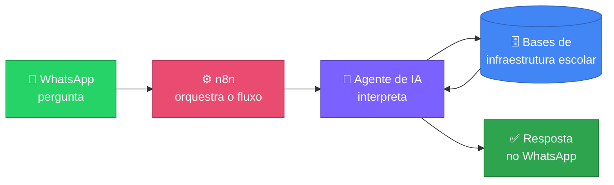
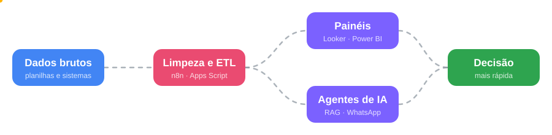

 

 

## 👋 Sobre mim

Sou **Analista de Dados** no setor público de educação. Meu dia a dia é pegar dados de **infraestrutura escolar** e de **controle de contratos** — normalmente espalhados em planilhas e sistemas diferentes — e transformar em painéis, automações e agentes que ajudam a decidir mais rápido.
Formado em **Ciência da Computação**.

<b>🇬🇧 Read in English</b>

 

I'm a **Data Analyst** in the public education sector, turning school infrastructure and contract data into faster decisions: dashboards, automations and AI agents on top of data that usually lives scattered across spreadsheets and systems. Background in **Computer Science**.

## 🔧 O que eu faço

<table>
  <tr>
    <td width="50%" valign="top">
      <h3>📊 Análise &amp; visualização</h3>
      Painéis e indicadores em <b>Looker Studio</b>, <b>Power BI</b>, Excel e Google Sheets.
    </td>
    <td width="50%" valign="top">
      <h3>⚙️ Automação</h3>
      Fluxos de ETL e integração com <b>n8n</b> e <b>Google Apps Script</b>.
    </td>
  </tr>
  <tr>
    <td width="50%" valign="top">
      <h3>🤖 IA aplicada</h3>
      Agentes de IA, <b>RAG</b> e chatbots para consultar dados em linguagem natural.
    </td>
    <td width="50%" valign="top">
      <h3>🏛️ Dados governamentais</h3>
      Infraestrutura escolar e controle financeiro de contratos.
    </td>
  </tr>
</table>

## 🛠️ Stack

  

## 📌 Em destaque

### 🤖 Agente de IA para consulta de dados

Integração **WhatsApp + n8n** para perguntar, em linguagem natural, sobre as bases de infraestrutura escolar.

### 📥 Pipeline RAG

Chatbot para busca em fichas técnicas, com **Supabase** e **Google Drive**.

### 📈 Dashboards educacionais

Indicadores de infraestrutura escolar no **Looker Studio**.

### 🗺️ Escolas por proximidade

Página que ajuda a encontrar escolas próximas a partir de um bairro de Teresina — o código está aqui mesmo, neste repositório, em [`escolas-por-proximidade/`](./escolas-por-proximidade).

## 🧭 Como eu trabalho

## 🐍 Atividade

<picture>
  <source media="(prefers-color-scheme: dark)" srcset="https://raw.githubusercontent.com/JorgeVarao/JorgeVarao/output/github-snake-dark.svg" />
  
</picture>

## 📫 Vamos conversar?

  

⭐ Sinta-se à vontade para explorar os repositórios &nbsp;|&nbsp; Feel free to explore the repos

